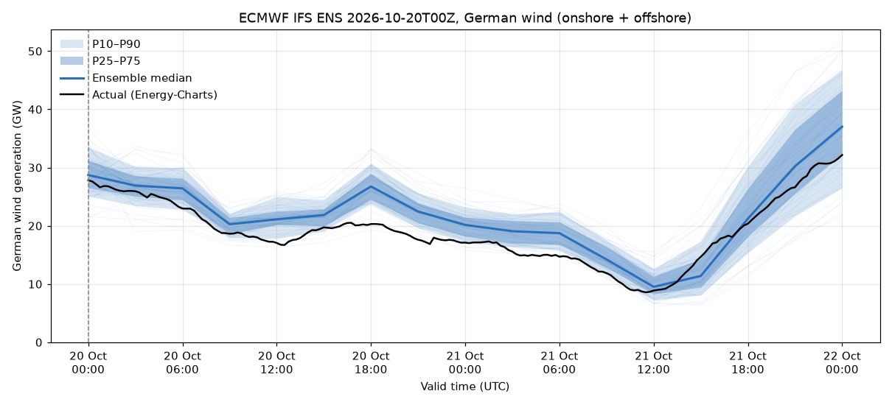
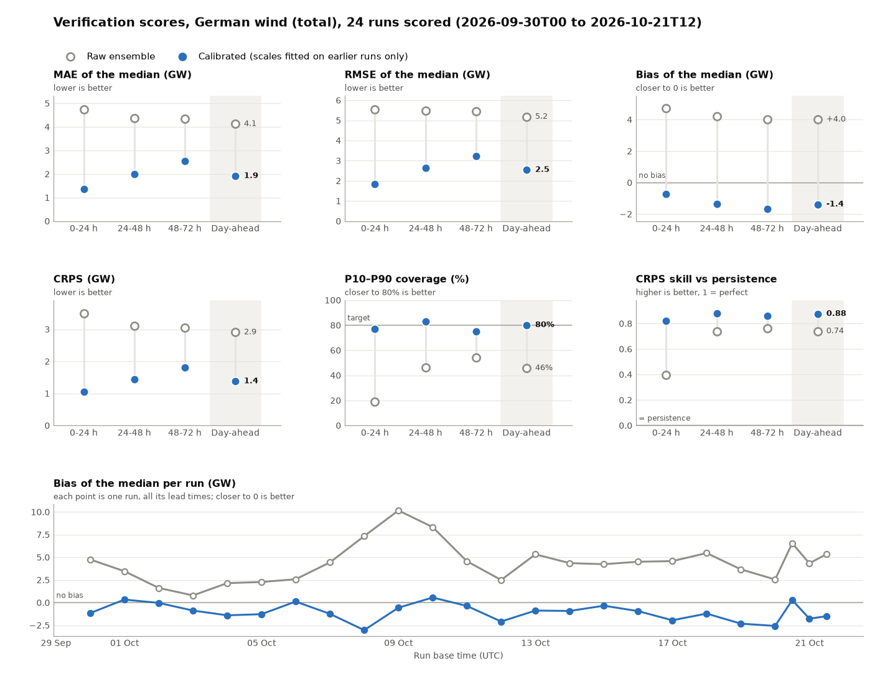
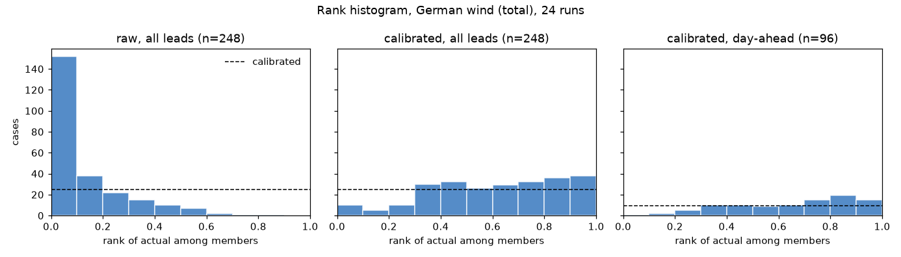
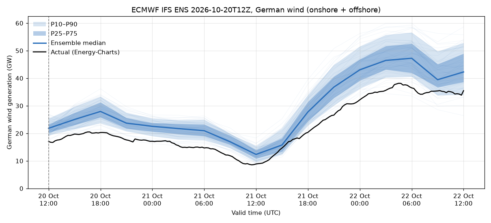
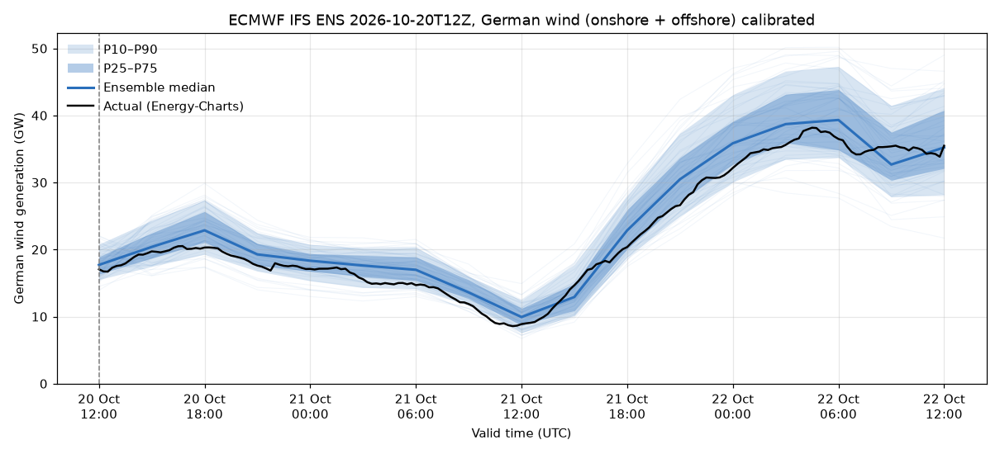

# Forecast vs Generation

A probabilistic forecast of German wind power generation, built from the ECMWF IFS ensemble (ENS) and verified against actual output.

```
ECMWF open data (ENS, 50 perturbed members, 100 m u/v, 0.25°)
  └─ ecmwf-opendata ─▶ GRIB2 ─▶ eccodes decode + crop to DE ─▶ cube (member, step, lat, lon)
        └─ |u,v| ─▶ shear to hub height ─▶ power curve ─▶ capacity factor per cell
              └─ capacity-weighted regions (onshore land / offshore sea) ─▶ national MW per member
                    └─ quantiles P10…P90  ◀── compared with ──▶  Energy-Charts / SMARD actuals
                          └─ FastAPI: /forecast /actuals /verify /chart (fan chart PNG)
```



See [Results](#results-31-runs-23-sep--21-oct-2026) for the month-long evaluation.

## Setup

```bash
python -m venv .venv
.venv/Scripts/python -m pip install -e ".[dev]"
```

On Windows, `eccodes` installs from a binary wheel. If that fails, use `conda install -c conda-forge eccodes`.

## Run

```bash
# a run from 2-3 days ago, 48 h horizon, so actuals already exist for most of it
.venv/Scripts/python scripts/run_pipeline.py --run 2026-10-20T00 --max-step 48

# older runs: the ECMWF server keeps about 4 days; Azure has the archive (slower)
.venv/Scripts/python scripts/run_pipeline.py --run 2026-10-10T00 --max-step 48 --source azure

# full 6-day horizon of the newest run
.venv/Scripts/python scripts/run_pipeline.py --run latest --max-step 144

# backfill a month of 00Z runs from the Azure archive (48 h, 6-hourly steps, ~1.2 GB download per run;
# retries with backoff, kills a hung run after 30 min, then refetches actuals for the whole range)
.venv/Scripts/python scripts/backfill.py --start 2026-09-23 --end 2026-10-19

# rolling-origin evaluation of the calibration, pooled over all runs; then a final fit for new runs.
# Writes data/evaluation.json, the scorecard data/scores.png and data/rank_histogram.png
.venv/Scripts/python scripts/calibrate.py

# API + chart
.venv/Scripts/python -m uvicorn windfc.api:app --reload
```

Then open http://127.0.0.1:8000/ for the chart or http://127.0.0.1:8000/docs for the API.

**Download size:** every field is global (about 1.3 MB), even though only Germany is kept. A 48 h run (50 members × 2 params × 17 steps) is about 2.2 GB, and a 144 h run is about 6.4 GB. The client fetches only the needed fields through byte ranges from the `.index` files. The pipeline crops right after decoding, stores a ~20 MB cube in `data/cube/`, and deletes the raw GRIB files unless you pass `--keep-raw`. `--step-interval 6` halves the download.

**Sources:** use `ecmwf` (the default, fastest) for the last ~4 days and `azure` for older runs. AWS has the same archive, but S3 throttles the client's multi-range requests with `503 Slow Down`.

| Endpoint | What it returns |
|---|---|
| `GET /runs` | Cached runs and the installed capacity |
| `GET /forecast?run=latest&fleet=total&calibrated=false` | Ensemble mean and P10/P25/P50/P75/P90 per valid time (MW) |
| `GET /actuals?start=...&end=...` | Actual onshore, offshore and total wind output (MW, 15 min) |
| `GET /verify?run=latest` | MAE, RMSE and bias of the median, CRPS, P10–P90 coverage and CRPS skill against persistence: overall, by lead time and for the day-ahead window, plus the rank histogram |
| `GET /chart?run=latest` | Fan chart PNG with the actuals drawn over it |
| `GET /evaluation` | Pooled raw and calibrated scores of all scored runs: overall, by lead time, day-ahead and per run (`data/evaluation.json`) |
| `GET /evaluation/chart` | The scorecard PNG: every score, raw against calibrated, plus bias per run |
| `GET /evaluation/rank-histogram` | The rank histogram PNG |

`fleet` can be `total`, `onshore` or `offshore`.

## Code map

| File | Role |
|---|---|
| [config.yaml](config.yaml) | Crop box, power curves, availability, regions and installed capacity |
| [src/windfc/download.py](src/windfc/download.py) | `ecmwf-opendata` retrieval in step chunks, plus the land-sea mask |
| [src/windfc/decode.py](src/windfc/decode.py) | `eccodes` message loop, grid geometry and crop |
| [src/windfc/power.py](src/windfc/power.py) | Wind speed, shear and power curve |
| [src/windfc/aggregate.py](src/windfc/aggregate.py) | Regional cos(lat)-weighted CF × capacity, giving MW per member; quantiles |
| [src/windfc/actuals.py](src/windfc/actuals.py) | Energy-Charts `public_power` with SMARD `chart_data` as fallback; alignment to valid times |
| [src/windfc/verify.py](src/windfc/verify.py) | Per-valid-time score table (CRPS, randomized PIT, persistence, day-ahead flag) and pooled scores |
| [src/windfc/calibrate.py](src/windfc/calibrate.py) | Least-squares scale factor per fleet, fitted only on actuals known before a cutoff |
| [scripts/backfill.py](scripts/backfill.py) | Runs the pipeline over a date range, then refetches the actuals for the whole range |
| [scripts/calibrate.py](scripts/calibrate.py) | Rolling-origin evaluation (`data/evaluation.json`, `data/scores.png`, `data/rank_histogram.png`) and the final fit |
| [src/windfc/api.py](src/windfc/api.py), [chart.py](src/windfc/chart.py) | FastAPI service; matplotlib fan chart, rank histogram and scorecard |

## Method notes (interview talking points)

- **Why an ensemble:** the 50 perturbed members (the open data does not include the control) are equally likely, and they sample the uncertainty in the initial conditions and the model. The spread between them gives a usable forecast distribution, and traders price risk from those quantiles, not from a single deterministic line. ENS runs 4 times a day (00/06/12/18 UTC). The 00/12 runs go out to 15 days; the 06/18 runs go out to 6 days.
- **Wind at 100 m:** this is close to modern hub heights (about 100–160 m). A power-law shear (α = 0.14) lifts the wind to 120 m for onshore turbines. Real shear depends on atmospheric stability: it is larger at night and in stable conditions, and that is a known source of error.
- **Power curve:** a generic fleet curve per fleet (cut-in 3 m/s, rated about 12–14 m/s, cut-out 25 m/s). It is applied per grid cell before averaging, because the curve is non-linear. Averaging the wind first and then applying the curve would bias the result.
- **Capacity weighting:** about 67 GW onshore is split into rough regional boxes, and the north and east carry the most weight. Offshore has about 8.3 GW in the North Sea and 1.6 GW in the Baltic. With the land-sea mask, onshore regions use only land cells and offshore regions use only sea cells.
- **Verification:**
  - MAE and RMSE of the median show deterministic skill.
  - CRPS = E|X − y| − ½E|X − X′| scores the whole distribution. It is in MW, and with a single member it reduces to MAE.
  - P10–P90 coverage should be about 80%. Low coverage can mean an under-dispersive ensemble or a biased one; the rank histogram separates the two (see Results: here it was bias).
  - Scores are broken down by lead time to show how skill decays.
  - **Day-ahead window:** the 00 UTC run is the one in hand before the 12:00 CET day-ahead auction gate closure, so the slice that matters for trading is its next Berlin delivery day (lead about 22–46 h). 12 UTC runs arrive after gate closure and never count as day-ahead.
  - **Persistence benchmark:** the actual at the run's base time, held for every lead. ENS and persistence then use information up to the same moment. Persistence is deterministic, so its CRPS is its MAE, and CRPSS = 1 − CRPS_ens / MAE_persistence.
  - **Rank histogram:** the rank of the actual among the 50 members, randomized over ties (the offshore fleet often has all members on the flat top of the curve) and mapped to [0, 1), so any number of bins has a flat expectation. A U shape means under-dispersion, a hump means over-dispersion, and a pile on the left means the forecast is too high.
- **Calibration, rolling origin:** runs are taken in base-time order. Each run is calibrated with scales fitted only on earlier runs and only on actuals known at its base time, which is how it would have run live. Leave-one-run-out is not out of sample here: runs overlap in valid time, so a held-out run's actuals sit in the other runs' training data. The first `--min-train` runs (default 7) are a warm-up and are not scored. `calibration.json` keeps each run's rolling-origin scales, and the API uses them for that run (`calibration_scope: out-of-sample`); other runs get the fit on all runs (`all-runs`).

## Results (31 runs, 23 Sep – 21 Oct 2026)

29 daily 00Z runs (48 h, 6-hourly) plus two 12Z runs (3-hourly). Rolling origin: the first 7 runs are warm-up, and the other 24 runs (248 valid times) are scored. Calibrated means each run uses the scales fitted only on what was known at its base time. Total = onshore + offshore, MW. From `scripts/calibrate.py`.

| Total | n | MAE | CRPS | Bias | P10–P90 cov. | CRPSS vs persistence |
|---|---|---|---|---|---|---|
| Raw, all leads | 248 | 4544 | 3271 | +4446 | 35% | 0.64 |
| Calibrated, all leads | 248 | 1759 | 1296 | −1095 | 79% | 0.86 |
| Raw, day-ahead | 96 | 4126 | 2909 | +4011 | 46% | 0.74 |
| **Calibrated, day-ahead** | 96 | **1919** | **1382** | −1379 | **80%** | **0.88** |
| Persistence, day-ahead | 96 | 11195 | | | | |



- **The raw forecast is about 4.4 GW too high, and that bias, not a lack of spread, is what drags coverage down.** Once the bias is scaled away, total coverage is 79–80%, and the calibrated rank histogram (`data/rank_histogram.png`) has no U shape.
- **Day-ahead MAE of 1.9 GW is about 2.5% of the ~77 GW installed.** It beats persistence clearly (CRPSS 0.88). The next benchmark to beat is the TSOs' own day-ahead forecast.
- **Offshore stays poorly calibrated:** coverage is 25% even after scaling. Most members sit on the flat top of the power curve, so the offshore spread collapses, and a scale factor cannot bring it back. Raw offshore is no better than persistence (CRPSS −0.03).
- **The bias drifts.** Fitted one week at a time, the actual/forecast ratio rises from 0.78 to 0.86 onshore and from 0.49 to 0.75 offshore over the month. The expanding-window scale lags behind it, which leaves the calibrated forecast about 1.1 GW too low (the rank histogram slopes up to the right).
- **Caveats:** this is one month (autumn), and neighbouring valid times are strongly correlated, so treat it as about 24 independent days, not 248 cases.



The 2026-10-20 12Z run, raw and calibrated with the rolling-origin scales it would have had live:

| Raw | Calibrated (out-of-sample) |
|---|---|
|  |  |

## Limitations and next steps

- Capacities and region boxes are rough. Next step: per-turbine capacity and hub height from the Marktstammdatenregister.
- There is no modelling of curtailment (redispatch, negative prices), icing, wakes or outages. Availability is a single constant factor.
- The fleet power curve is generic. A better approach is to learn an empirical curve (wind → CF) from history.
- Calibration only rescales, with an expanding window that lags the drifting bias. Next steps: a trailing window (7–14 days), an empirical fleet power curve without a hard plateau (offshore spread), EMOS / NGR or quantile regression for the spread, and benchmarks against the TSO day-ahead forecast (SMARD / ENTSO-E), ICON-EU and ICON-D2-EPS.
- The forecast is instantaneous every 3 h, while the actuals are 15-min values averaged over an hour around each valid time.
